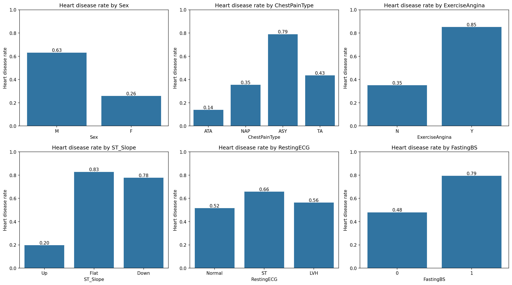
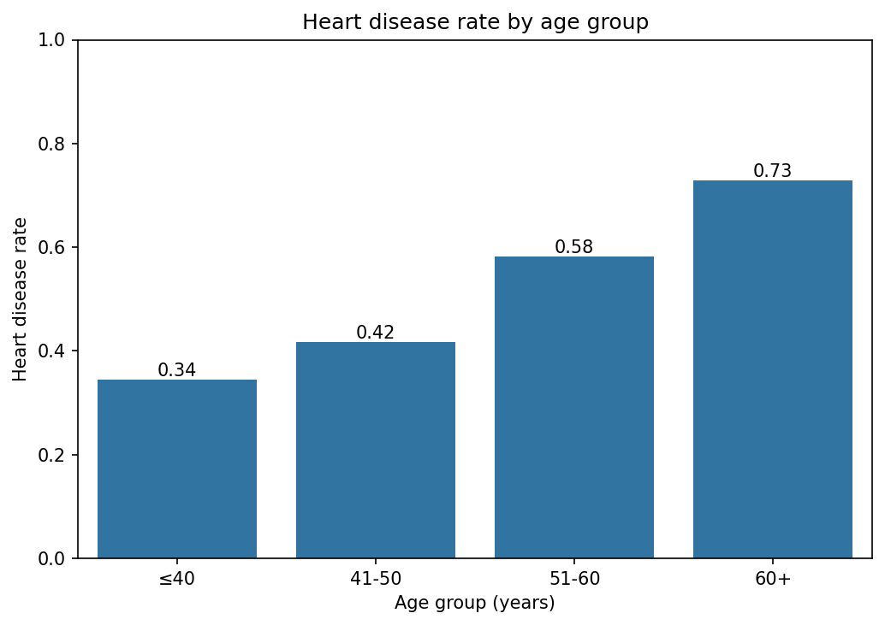
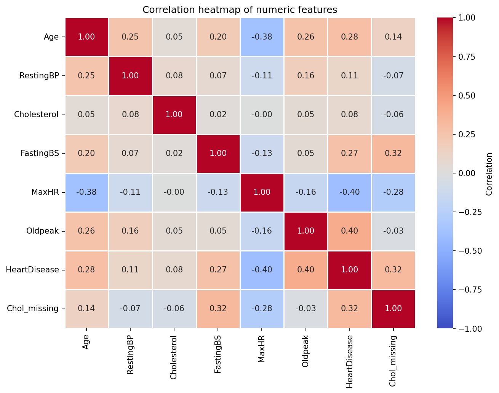

# Heart Disease Data Analysis

Exploratory data analysis (EDA) and visualization of a clinical dataset to identify the factors most strongly associated with heart disease.


---

## Table of Contents

1. [Project Overview](#project-overview)
2. [Dataset](#dataset)
3. [Data Cleaning](#data-cleaning)
4. [Visualizations and Key Findings](#visualizations-and-key-findings)
5. [Conclusions](#conclusions)
6. [Limitations](#limitations)
7. [Project Structure](#project-structure)
8. [How to Run](#how-to-run)

---

## Project Overview

The goal of this project is to explore a medical dataset of 918 patients and answer one question:

> **Which patient characteristics are most associated with heart disease?**

The analysis covers data quality checks, cleaning of impossible values, and three groups of visualizations (categorical bar plots, age and sex comparison, and a correlation heatmap), followed by conclusions.

## Dataset

- **File:** `data/heart.csv`
- **Size:** 918 patients, 12 columns, no missing (NaN) cells and no duplicate rows
- **Target variable:** `HeartDisease` (1 = heart disease, 0 = healthy)
- **Class balance:** about 55% heart disease (508 patients) and 45% healthy (410 patients), so the classes are well balanced
- **Source:** Heart Failure Prediction Dataset (Kaggle). *Please check the dataset page for the original license and citation.*

| Column | Description |
|---|---|
| `Age` | Age of the patient (years) |
| `Sex` | M = male, F = female |
| `ChestPainType` | TA = typical angina, ATA = atypical angina, NAP = non-anginal pain, ASY = asymptomatic |
| `RestingBP` | Resting blood pressure (mm Hg) |
| `Cholesterol` | Serum cholesterol (mg/dl) |
| `FastingBS` | Fasting blood sugar: 1 if > 120 mg/dl, otherwise 0 |
| `RestingECG` | Resting ECG result: Normal, ST (ST-T wave abnormality), LVH (left ventricular hypertrophy) |
| `MaxHR` | Maximum heart rate achieved |
| `ExerciseAngina` | Exercise-induced angina: Y = yes, N = no |
| `Oldpeak` | ST depression induced by exercise relative to rest |
| `ST_Slope` | Slope of the peak exercise ST segment: Up, Flat, Down |
| `HeartDisease` | Target: 1 = heart disease, 0 = healthy |

## Data Cleaning

A check for NaN values found nothing, but the summary statistics revealed **hidden missing values encoded as 0**:

| Problem | Rows affected | Action |
|---|---|---|
| `Cholesterol = 0` (physiologically impossible) | 172 (about 19%) | Converted to `NaN`, imputed with the median, and flagged in a new column `Chol_missing` |
| `RestingBP = 0` (physiologically impossible) | 1 | Row removed |

**Why not simply drop the 172 cholesterol rows?** About 88% of these patients have heart disease, so the zeros are not random. Dropping them would distort the class balance and bias the results. The `Chol_missing` flag keeps that information.

**Impact of cleaning:** before cleaning, the zeros pulled the mean cholesterol down to about 199 and even reversed the difference between groups (patients appeared to have *lower* cholesterol). After cleaning, the minimum is a realistic value (85) and patients show slightly higher cholesterol than healthy people, as expected.

`Oldpeak` contains negative values (minimum -2.6). These were kept, because ST segment changes can be both depressions and elevations.

## Visualizations and Key Findings

### 1. Heart disease rate by categorical features



Each bar shows the **share of patients with heart disease** in that category.

| Feature | Finding |
|---|---|
| `ST_Slope` | Flat 83% and Down 78%, versus only 20% for Up |
| `ExerciseAngina` | 85% with exercise angina, versus 35% without |
| `ChestPainType` | ASY (asymptomatic) 79%, versus only 14% for ATA |
| `Sex` | Men 63%, women 26% |
| `FastingBS` | 79% with high fasting blood sugar, versus 48% with normal |
| `RestingECG` | Small differences (52% to 66%), a weaker feature |

### 2. Heart disease rate by age group



The rate rises steadily with age: from **34%** (40 years or younger) to **42%** (41-50), **58%** (51-60) and **73%** (over 60).

### 3. Heart disease rate by sex


Men show a heart disease rate of **63%** compared with **26%** in women, about 2.4 times higher.

### 4. Correlation heatmap



Correlation of numeric features with `HeartDisease`:

| Feature | Correlation |
|---|---|
| `Oldpeak` | +0.40 |
| `MaxHR` | -0.40 |
| `Age` | +0.28 |
| `FastingBS` | +0.27 |
| `RestingBP` | +0.12 |
| `Cholesterol` | +0.08 |

Higher `Oldpeak` and lower `MaxHR` are the strongest numeric signals, while `Cholesterol` and `RestingBP` are weak indicators in this dataset.

## Conclusions

- The strongest indicators of heart disease are **a flat or downward ST slope, exercise-induced angina, asymptomatic chest pain (ASY), male sex, older age, a high Oldpeak value and a low maximum heart rate**.
- **Asymptomatic chest pain is the highest-risk type** (79%), which shows that the absence of symptoms does not mean the absence of risk.
- **Cholesterol and resting blood pressure are weak indicators** in this dataset.
- Data cleaning changed the conclusions: without handling the hidden zeros, cholesterol would have appeared to *protect* against heart disease.

## Limitations

- **Sex imbalance:** about 79% of patients are men (725 of 918), so conclusions for women are less reliable.
- **Small categories:** for example `ST_Slope = Down` (63 patients) and `ChestPainType = TA` (46 patients), so their rates are less stable.
- **Correlation is not causation:** the analysis shows statistical association only.
- Each plot looks at one variable at a time and does not capture combined effects of several variables.
- The 172 imputed cholesterol values are estimates, not real measurements.

## Project Structure

```
heart-disease-analysis/
├── data/
│   └── heart.csv                  # dataset
├── images/                        # saved plots used in this README
│   ├── categorical_barplots.png
│   ├── age_barplot.png
│   ├── sex_barplot.png
│   └── correlation_heatmap.png
├── analysis.ipynb                 # full analysis notebook
└── README.md
```

## How to Run

1. Clone the repository:
   ```bash
   git clone https://github.com/YOUR_USERNAME/heart-disease-analysis.git
   cd heart-disease-analysis
   ```
2. Install the required libraries:
   ```bash
   pip install numpy pandas matplotlib seaborn jupyterlab
   ```
3. Launch JupyterLab and open the notebook:
   ```bash
   jupyter lab
   ```
4. Open `analysis.ipynb` and run all cells (**Kernel → Restart Kernel and Run All Cells**).

## Tools

Python, NumPy, Pandas, Matplotlib, Seaborn, JupyterLab

## Author

**Bahar Niyazi**
GitHub: [@BaharNiyazi](https://github.com/BaharNiyazi)
